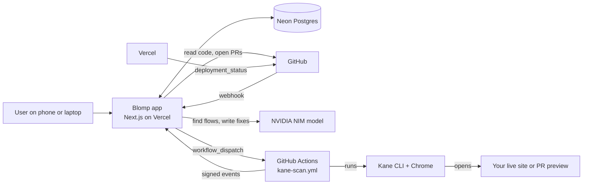

# Blomp

**CI is green. Is your signup?**

Blomp has [Kane CLI](https://github.com/LambdaTest/kane-cli) open your live website in a real browser and walk through the things your users do: sign up, log in, add to cart, check out. It shows you which flows work and which are broken, opens a pull request for a broken one, and has Kane check the fix on the pull request's preview before it says **Kane verified**.

- **Live app:** https://blomp.vercel.app
- **Built for:** the KaneCLI Online Hackathon by TestMu AI
- **Demo video:** _link added at submission_

## How it works

1. **Connect GitHub** and pick a repo. Blomp guesses the live site from the repo's Vercel deployments.
2. **Find the flows.** Blomp reads your code and proposes 3 to 5 user flows, each in plain words ("Add the Trail Backpack to the cart and see a total of $64.00"). Edit, add or turn off any of them.
3. **Scan.** Kane runs every flow on your live site in a real Chrome browser. A live terminal shows each step as it happens, and a ring shows the score.
4. **Read the verdict.** Each flow is **pass**, **fail** or **unknown**. Unknown means Kane could not decide, and it is never counted as a pass. A failed flow shows Kane's own diagnosis, the failing step and a screenshot.
5. **Fix.** Tap "Fix this with Blomp". Blomp's fixer reads the failing evidence and the likely files, writes the change (at most 3 files) and opens a pull request on a new branch. It never pushes to your default branch.
6. **Verify.** When Vercel finishes the pull request's preview, Kane re-runs only the broken flow on that preview. If it passes, Blomp comments **Kane verified** on the pull request. If it does not, it says so.
7. **Stay on it.** Turn on "Scan when I push" for a repo and every successful production deploy is scanned automatically. The Feed tab lists what happened: scans, broken flows, fixes proposed and verified.

## Judge guide: try it in about 10 minutes

You need a GitHub account and a web project to point Blomp at. You do not need a Kane account: the scans run on Blomp's own Kane account.

**Use a throwaway repo.** "Fix" adds a webhook to the repo and opens a pull request, and Blomp asks GitHub for the `repo` permission so it can read code and open that pull request.

**Prepare the repo**
- It is a web app deployed on Vercel (Next.js repos work best, they are what Blomp was tested on). Its production site is public.
- In the Vercel project, open Settings, Deployment Protection, and turn **Vercel Authentication off for Preview** deployments. Kane cannot sign in to Vercel, so a protected preview would fail the re-check.
- No broken repo handy? Fork [Big-BenW3/blomp-demo-shop](https://github.com/Big-BenW3/blomp-demo-shop), deploy it on Vercel, and break checkout on purpose: in `src/lib/validation.ts`, change the card check in `isValidCard` so a valid 16 digit card is rejected (for example `digits.length > 16`). Push it.

**Run the loop**
1. Open https://blomp.vercel.app and sign in with GitHub.
2. Tap your repo. Check the live site address near the top.
3. Tap **Find flows with AI** (the model can take a minute or more to think), review the list, then tap **Scan now**.
4. Watch the live terminal. A scan takes roughly 1 to 2 minutes, about 50 seconds of which is GitHub starting a browser.
5. Open a failed flow, read Kane's diagnosis, then tap **Fix this with Blomp**.
6. Open the pull request when it appears. Once the preview is built, Kane re-checks it and the pull request gets a **Kane verified** comment. If the comment is late, tap **Re-check now**.
7. Merge it. With "Scan when I push" on, the next production deploy is scanned by itself and the Feed shows it.

**If something does not work**
- *"Add your live site address first"*: the live address is empty, type it in.
- *The re-check fails on a protected preview*: Deployment Protection is on for previews (see above).
- *"The model is rate limited"*: Blomp already retried once, wait a minute and try again.
- *Kane cannot decide* (an unknown flow): the flow's wording was too vague, or the site needs something Kane cannot do. Edit the flow and scan again.

## Architecture



- **The app** (`src/`) is a Next.js App Router PWA with Auth.js (GitHub sign-in), Neon Postgres and Drizzle. The live terminal is a server-sent event stream.
- **The runner** (`runner/`, `.github/workflows/kane-scan.yml`) runs on a GitHub Actions machine, because Kane needs a real browser and Vercel functions do not have one. It runs one Kane objective per flow, turns Kane's output into events and posts them, signed with HMAC, to `/api/ingest`.
- **The verdict** comes only from Kane's exit code and its `run_end` event (`src/lib/kane/`). The AI models never decide pass or fail, and unknown is never counted as a pass.
- **The fix loop** (`src/lib/agent/fix.ts`, `src/lib/fixes/`, `src/lib/github/pr.ts`): the fixer is shown Kane's evidence and the best matching files, and answers with whole-file edits that are checked before use. Edits to workflows, lockfiles, env files, files it was not shown or more than 3 files are refused. The pull request is opened through the Git Data API as the user.
- **The re-check** is triggered by GitHub's `deployment_status` webhook (`/api/webhooks/github`, verified with `WEBHOOK_SECRET`). Auto-scan uses the same webhook for production deploys.
- **Tests** run without a database: `npm test` uses an in-memory Postgres (PGlite).

## Run it yourself

You need Node 22 or newer, a [Neon](https://neon.tech) database, a GitHub OAuth app, a GitHub fine-grained token, a Kane account and an [NVIDIA NIM](https://build.nvidia.com) API key.

```bash
npm install
cp .env.example .env.local   # fill in the values below
npm run db:migrate
npm run dev                  # http://localhost:3000
```

Scans only work from a deployed copy, because the runner posts its results back to a public address. Use the Vercel steps below for the full loop.

| Variable | What it is |
| --- | --- |
| `DATABASE_URL` | Neon pooled connection string |
| `AUTH_SECRET` | random string, `openssl rand -base64 32` |
| `AUTH_URL` | the app's public address, for example `https://blomp.vercel.app` |
| `AUTH_GITHUB_ID`, `AUTH_GITHUB_SECRET` | GitHub OAuth app. Callback: `<AUTH_URL>/api/auth/callback/github` |
| `GITHUB_DISPATCH_TOKEN` | fine-grained token with Actions read and write on this repo only |
| `GITHUB_REPOSITORY` | this repo, `owner/name` |
| `INGEST_SECRET` | shared secret that signs the runner's posts, `openssl rand -hex 32` |
| `WEBHOOK_SECRET` | secret for GitHub webhooks, `openssl rand -hex 32` |
| `NVIDIA_API_KEY`, `NVIDIA_MODEL` | NIM key and model (Blomp uses `moonshotai/kimi-k3.1-pro`) |
| `NVIDIA_BASE_URL` | optional, defaults to the NIM endpoint |
| `NVIDIA_TIMEOUT_MS` | optional, how long to wait for the model (default 240000) |
| `BLOB_READ_WRITE_TOKEN` | optional, Vercel Blob store for failure screenshots |

**Deploy on Vercel**
1. Import this repo into Vercel and add the variables above.
2. In this repo's GitHub settings, add the Actions secrets `KANE_USERNAME`, `KANE_ACCESS_KEY` (from your Kane account), `INGEST_SECRET` (same value as in Vercel) and `DATABASE_URL` (for the migrate workflow).
3. Run the `migrate` workflow once. It applies the Drizzle migrations to Neon.
4. In the GitHub OAuth app, untick "Expire user access tokens". Blomp stores the token once and does not refresh it.

**Checks:** `npm run lint`, `npm run typecheck`, `npm test`. The same three run in CI.

## Limits

- Websites only, and only Next.js repos deployed on Vercel have been tested.
- Up to 5 flows are on per repo (10 stored), and each flow is one Kane objective.
- A scan costs Kane credits (measured: roughly 5 to 17 per flow). Blomp's operator pays them, users never see credits.
- Fix edits at most 3 files and can be wrong. Kane re-checking the preview is the safeguard, which is why "verified" only appears after Kane passes it.
- The model that finds flows and writes fixes can take a minute or more per answer.
